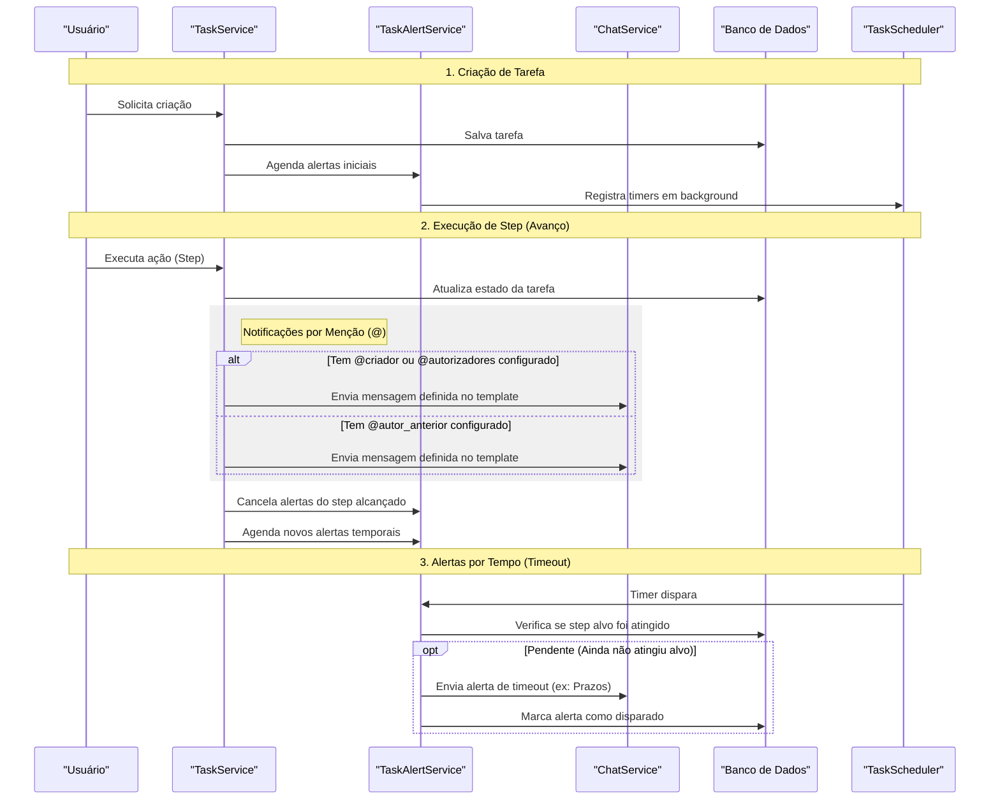

# Fluxo de Alertas NeoKioski

Este documento detalha o fluxo técnico dos alertas configurados no sistema.

## Diagrama de Fluxo

## Regras de Notificação

1. **Silêncio por Padrão**: O sistema não envia mensagens automáticas como "Tarefa criada" ou "Tarefa avançou".
2. **Controle Total pelo Template**: Mensagens de chat só ocorrem se houver uma configuração de **@menção** associada ao Step no Template da tarefa.
3. **Alertas por Papel (Role)**: Quando uma mensagem é disparada (por menção ou tempo), ela carrega os metadados das roles interessadas para que o som seja reproduzido apenas nos dispositivos autorizados.

## Variáveis Disponíveis nos Templates
- **@criador**: Autor original da tarefa.
- **@autorizadores**: Usuários com permissão de assinatura.
- **@usuario**: Quem executou a ação atual.
- **@autor_anterior**: Quem executou o passo imediatamente anterior.
- **@resposta**: Texto inserido no campo de resposta do passo.
